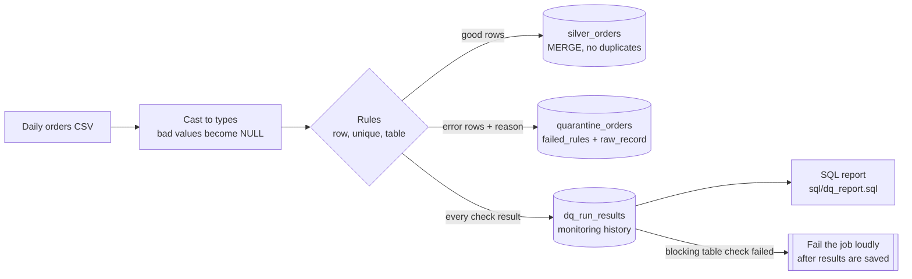

# Delta Data Quality & Pipeline Monitoring

A small ETL pipeline whose real subject is **bad data**: detect it, quarantine it with the reason, record every check result, and report on pipeline health with SQL. The demo data has a *known* number of injected faults, so the pipeline can prove it catches all of them.

## Architecture



## Checks implemented

| Type | Check | Severity |
|---|---|---|
| Required fields | `order_id`, `customer_id` not null | error → quarantine |
| Valid ranges | `amount` in (0, 100000], `order_date` not in the future | error |
| Valid values | `status` in an allowed list; `email` matches a pattern | error |
| Reasonable values | `quantity` between 1 and 50 | **warn** → row kept, reported |
| Uniqueness | `order_id` unique (later duplicates are flagged) | error |
| Row-count expectation | total rows within 200–5000 | table-level, fails job |
| Error-rate ceiling | ≤ 10% of rows quarantined | table-level, fails job |
| Volume vs previous run | ≥ 50% of the last run's row count | table-level, fails job |

## What this showcases

- **Detecting and troubleshooting bad data**, not just processing good data: `quarantine_orders` keeps the raw record and the list of failed rules, and `sql/dq_report.sql` has a query to pull actual bad records for any rule.
- **Observability:** every run writes one row per check to `dq_run_results`, so you can chart pass rates, find the noisiest rule and spot volume anomalies.
- **Correct failure semantics:** results are recorded *before* the job fails, so a blocked run is still visible in the history.
- **Verifiability:** `expected_failures.json` states how many rows each rule should flag, and the notebook asserts it.
- **Idempotent writes:** Silver `MERGE` on `order_id`; quarantine is replaced per source file.

## Run it

1. Generate the data (already included in `data/`):
   ```bash
   python src/sample_data.py --out data
   python -m unittest discover -s tests -v     # checks the data against its manifest, no Spark needed
   ```
2. In Databricks, upload `data/orders_day1.csv`, `orders_day2.csv` and `expected_failures.json` to `/Volumes/main/dq_demo/raw/` (the notebook creates the schema and volume on first run; just run once, upload, run again).
3. Run `notebooks/01_run_dq_pipeline.py` with `source_file = orders_day1.csv` → healthy run with 52 quarantined rows and 9 warnings.
4. Run it again with `source_file = orders_day2.csv` → the volume drops to ~30% of the previous run, the **volume_vs_previous_run** check fails, and the job raises *after* recording it. Set `fail_on_check_failure=false` if you only want to look.
5. Open `sql/dq_report.sql` to see the run history, failing rules, quarantine breakdown and reconciliation.

## Layout

```
src/dq_framework.py      rule objects + PySpark functions (apply, split, summarize, table checks)
src/sample_data.py       reproducible dirty data + manifest (stdlib only)
notebooks/01_run_dq_pipeline.py
sql/dq_report.sql
tests/test_sample_data.py
data/                    generated sample files
```

## Notes

- The Spark code is not unit-tested locally (no Spark in my build environment); the notebook's manifest assertion is the end-to-end check, and the data generator is covered by local tests.
- Natural extensions: store rules in a Delta table or YAML, add freshness checks, send a Slack/email alert from the failing branch, or port the rules to Lakeflow Declarative Pipelines expectations.
